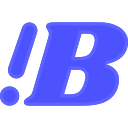

<p align="center"><a href="https://bestimage.ai/"></a></p>

# Awesome Kling 4.0 Prompts

**108 original video prompts across 12 collections, with official Kling 4.0 examples and entry guides in 15 languages.** Curated by [bestimage.ai](https://bestimage.ai/) for creators planning stories, product films, social clips, character performances, and controlled video edits.

[](https://bestimage.ai/)
[](https://bestimage.ai/models/kuaishou/kling-4-0-text-to-video/)
[](https://bestimage.ai/models/kuaishou/kling-4-0-image-to-video/)
[](LICENSE)

English · [简体中文](README.zh-CN.md) · [繁體中文](README.zh-TW.md) · [日本語](README.ja.md) · [한국어](README.ko.md) · [Español](README.es.md) · [Français](README.fr.md) · [Deutsch](README.de.md) · [Português do Brasil](README.pt-BR.md) · [Italiano](README.it.md) · [العربية](README.ar.md) · [Русский](README.ru.md) · [Bahasa Indonesia](README.id.md) · [ไทย](README.th.md) · [Tiếng Việt](README.vi.md)

[Browse every prompt](prompts/README.md) · [Watch official examples](docs/official-examples.md) · [Write a better brief](docs/prompting-guide.md) · [Explore Kling on bestimage.ai](docs/bestimage-workflow.md)

## Find a scene for your project

| Your goal | Start here | What you will direct |
| --- | --- | --- |
| Tell a small story | [Cinematic stories](prompts/cinematic-stories.md) | Suspense, character decisions, and emotional payoffs |
| Show a product clearly | [Product films](prompts/product-films.md) | Advertising edits, mechanisms, material, and final composition |
| Make a short creator clip | [Creator and social](prompts/creator-social.md) | A readable hook and a concise payoff |
| Direct speech or expression | [Dialogue and performance](prompts/dialogue-performance.md) | Speaker turns, gaze, pauses, and reactions |
| Keep motion readable | [Action and camera](prompts/action-camera.md) | Sports, science-fiction flight, fantasy reveals, and contact |
| Build a handmade world | [Animation](prompts/animation-worlds.md) | Paper, clay, textile, glass, and original characters |
| Film a tactile process | [Food and craft](prompts/food-craft.md) | Material changes caused by visible contact |
| Create atmosphere | [Nature and spaces](prompts/nature-spaces.md) | Water, light, weather, and connected rooms |
| Combine reference assets | [Omni Reference](prompts/omni-reference.md) | Separate roles for identity, scene, material, and motion |
| Revise existing footage | [Video editing](prompts/video-editing.md) | A bounded change with source details preserved |
| Reach a prepared composition | [Keyframes](prompts/keyframe-transitions.md) | Continuous action between important visual moments |
| Explain or prepare a shot | [Design and education](prompts/design-education.md) | Motion graphics, visual explanations, and production studies |

## Official Kling 4.0 examples

Explore videos and reference assets published in the [official Kling 4.0 User Guide](https://kling.ai/quickstart/kling-4-model-user-guide). The gallery contains **12 example groups**, with input-role notes, directing lessons, viewing checks, and related practice recipes. Click a preview to watch the official result.

| Preview | Official example |
| --- | --- |
| [](https://static--94.klingai-cdn-aws.com/kling-blog/presigned_url/2a2039c8-2a39-48cb-83b6-a3a4f95b4446_1-3.mp4) | [Camera reference](docs/official-examples.md#o03) · [Watch video](https://static--94.klingai-cdn-aws.com/kling-blog/presigned_url/2a2039c8-2a39-48cb-83b6-a3a4f95b4446_1-3.mp4) |
| [](https://static-60.klingai-cdn-aws.com/kling-blog/presigned_url/13c66fc3-b663-4e6e-b50c-208bbd080a5c_1-4.mp4) | [Foreground removal](docs/official-examples.md#o07) · [Watch video](https://static-60.klingai-cdn-aws.com/kling-blog/presigned_url/13c66fc3-b663-4e6e-b50c-208bbd080a5c_1-4.mp4) |
| [](https://static-9.klingai-cdn-aws.com/kling-blog/presigned_url/e195bd1a-13ae-4d52-a67b-00b14f3972b6_1-5.mp4) | [Local character stylization](docs/official-examples.md#o08) · [Watch video](https://static-9.klingai-cdn-aws.com/kling-blog/presigned_url/e195bd1a-13ae-4d52-a67b-00b14f3972b6_1-5.mp4) |
| [](https://static--34.klingai-cdn-aws.com/kling-blog/presigned_url/e8b7cc55-4cb6-4a0c-b175-e22d1f378f5f_1-2.mp4) | [First and last frames](docs/official-examples.md#o11) · [Watch video](https://static--34.klingai-cdn-aws.com/kling-blog/presigned_url/e8b7cc55-4cb6-4a0c-b175-e22d1f378f5f_1-2.mp4) |

[View all official examples and input references →](docs/official-examples.md)

These are Kling AI's published examples. The original prompts in this repository are separate creative recipes; the official videos are not presented as their generated results. Media remains with its original publisher. See [source records](assets/README.md).

## A complete prompt to start with

### K001 — The returned umbrella

A quiet shop scene with one object, one small gesture, and a warm finish.

**Mode:** text to video · **Creative brief:** 10 seconds, 16:9 · **Inputs:** none

```text
A continuous ten-second medium-wide shot inside a small umbrella repair shop after rain. An adult shopkeeper in a dark green apron stands behind a wooden counter. One closed yellow umbrella lies horizontally on the counter with its curved handle pointing right. During the first three seconds, the shopkeeper slides a folded blue cloth beneath the umbrella. From three to seven seconds, they slowly rotate the closed umbrella a quarter turn so the repaired seam faces the customer. During the final three seconds, they withdraw both hands and smile gently toward the customer just outside the frame. The camera moves slightly closer without changing sides. Soft window light reveals wet pavement outside and the matte yellow fabric inside. Sound: quiet rain outside, cloth brushing wood, and one small handle tap. No dialogue, subtitles, or background music. Keep the umbrella closed, with the same handle, fabric color, and position on the counter.
```

**Adjust:** umbrella color, apron color, window light. **Review:** one umbrella remains closed; the cloth stays beneath it; the seam rotates with the fabric; hands release before the final hold.

[Open the full entry](prompts/cinematic-stories.md#k001) · [Explore Kling 4.0 Text to Video](https://bestimage.ai/models/kuaishou/kling-4-0-text-to-video/)

## More scenes worth trying

Choose a focused exercise or a longer directing brief. The scenes below include timed action, sound decisions, and specific continuity checks.

| Scene | Starting material | Creative challenge |
| --- | --- | --- |
| [K003 — The last parcel](prompts/cinematic-stories.md#k003) | Written scene | Build a suspense reversal with an off-screen reply |
| [K014 — Ceramic lid fit](prompts/product-films.md#k014) | Written product concept | Connect three advertising shots through one contact event |
| [K037 — The last hurdle](prompts/action-camera.md#k037) | Written sports scene | Keep takeoff, clearance, and landing readable |
| [K043 — The paper glider opens the sky](prompts/action-camera.md#k043) | Written fantasy scene | Reveal a new world through a continuous camera route |
| [K079 — Storyboard to finished puppet scene](prompts/omni-reference.md#k079) | Character design and storyboard | Turn panels into a miniature adventure with a visual payoff |
| [K088 — Change the drawer reveal](prompts/video-editing.md#k088) | Source footage and object image | Revise a reveal and its dialogue within the existing timing |
| [K095 — Three poses at the window](prompts/keyframe-transitions.md#k095) | Three compatible portraits | Reach timed poses through natural movement |
| [K104 — A network finds its route](prompts/design-education.md#k104) | Written diagram | Explain selection, travel, and arrival through motion graphics |

## Full collection

| Collection | Recipes | IDs |
| --- | ---: | --- |
| [Cinematic stories](prompts/cinematic-stories.md) | 9 | K001–K009 |
| [Product films](prompts/product-films.md) | 9 | K010–K018 |
| [Creator and social videos](prompts/creator-social.md) | 9 | K019–K027 |
| [Dialogue and performance](prompts/dialogue-performance.md) | 9 | K028–K036 |
| [Action and camera movement](prompts/action-camera.md) | 9 | K037–K045 |
| [Animation and miniature worlds](prompts/animation-worlds.md) | 9 | K046–K054 |
| [Food and craft](prompts/food-craft.md) | 9 | K055–K063 |
| [Nature, travel, and spaces](prompts/nature-spaces.md) | 9 | K064–K072 |
| [Omni Reference direction](prompts/omni-reference.md) | 9 | K073–K081 |
| [Bounded video edits](prompts/video-editing.md) | 9 | K082–K090 |
| [Keyframes and transitions](prompts/keyframe-transitions.md) | 9 | K091–K099 |
| [Design, explanation, and production studies](prompts/design-education.md) | 9 | K100–K108 |


The catalog counts **108 unique creative recipes**. Translations of the shared sample and the 12 official example groups are counted separately. Each recipe has a stable ID, complete prompt, input description, adjustable details, and review target. Original recipes are not labeled as tested model outputs.

## Use a recipe in three steps

1. **Choose your starting point.** A written idea, an approved image, several references, existing footage, or prepared keyframes each needs a different brief.
2. **Make it yours.** Replace the subject and setting, assign each input a role, and keep only the actions that matter to your scene.
3. **Review the whole clip.** Check the defining motion, identity, contact, sound, and final image. Use the entry's review target to guide your next revision.

The [prompting guide](docs/prompting-guide.md) explains how to describe camera, timing, and sound. [Workflow guidance](docs/model-capabilities.md) helps choose the right inputs, and [troubleshooting](docs/troubleshooting.md) maps visible failures to focused revisions.

## Explore Kling 4.0 on bestimage.ai

Start from the material you already have:

| Starting point | Model page | Useful for |
| --- | --- | --- |
| A written idea | [Kling 4.0 Text to Video](https://bestimage.ai/models/kuaishou/kling-4-0-text-to-video/) | Stories, social concepts, atmosphere, and animation |
| An approved image | [Kling 4.0 Image to Video](https://bestimage.ai/models/kuaishou/kling-4-0-image-to-video/) | Product movement, portraits, and composition-led scenes |
| An application workflow | [bestimage.ai documentation](https://bestimage.ai/docs/) | Model documentation and integration guidance |

[bestimage.ai](https://bestimage.ai/) connects creative image and video workflows with model discovery and API documentation. Read the [creative workflow guide](docs/bestimage-workflow.md) to connect a prompt from this library to your own project.

## Languages

The English catalog and guides are the shared reference. Fifteen language entries explain how to use the library and translate the same complete umbrella scene: English, Simplified Chinese, Traditional Chinese, Japanese, Korean, Spanish, French, German, Brazilian Portuguese, Italian, Arabic, Russian, Indonesian, Thai, and Vietnamese.

These are localized entry guides, **not full translations of all 108 prompts**. Documentation language does not establish model speech support.

## Frequently asked questions

### Which prompt should I choose first?

Start with the scene closest to your actual inputs. A simple product action or one-person performance is easier to review than a dense scene with several simultaneous events.

### Can I use an official example's assets?

The gallery links to their original publisher and full source prompt. Media rights remain with the respective owners. Use your own or authorized assets when adapting a scene for your project.

### Are the official videos results of these prompts?

No. They are separately attributed examples published by Kling AI. The catalog contains independently written creative recipes.

### How do references differ from keyframes?

References define what assets contribute to a scene. Keyframes define important visual moments. See the [workflow guide](docs/model-capabilities.md) and choose the matching collection.

### Can I use the original prompts commercially?

The original repository text is distributed under the [MIT license](LICENSE). Input media, people, voices, and generated outputs may have separate applicable rights and terms.

## Contribute

Share a distinct scene, a helpful correction, or a documented result. Read [CONTRIBUTING.md](CONTRIBUTING.md), [submit a prompt](https://github.com/bestimageai/awesome-kling-4-0-prompts/issues/new?template=prompt.yml), or [request a scenario](https://github.com/bestimageai/awesome-kling-4-0-prompts/issues/new?template=scenario.yml).

## Earn with the bestimage.ai Affiliate Program

Publish prompt tutorials, creative guides, or model integrations? Explore the [bestimage.ai Affiliate Program](https://bestimage.ai/affiliate-program/) and earn commissions by introducing your audience to bestimage.ai. Eligibility and payouts follow the [affiliate agreement](https://bestimage.ai/affiliate-agreement/).

## License and attribution

Original prompt text and documentation: [MIT](LICENSE). Linked official media remains subject to its original rights and is excluded from this repository's license. Kling is a trademark of its respective owner; this is an independent library maintained by bestimage.ai.
